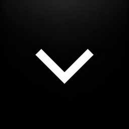

<p align="center">
  
</p>

<h1 align="center">FoldBar</h1>

<p align="center">A little more room in your Mac’s menu bar.</p>

<p align="center">
  <a href="README.md">简体中文</a> · <a href="README.en.md">English</a>
</p>

FoldBar is a native macOS utility for crowded menu bars, especially on Macs with a notch. Collect less-used icons in a floating panel, then click the FoldBar arrow in the menu bar to reach them.

**v0.2.0 · macOS 14+ · Apple Silicon / Intel · MIT**

[Download v0.2.0](https://github.com/Aenvo/FoldBar/releases/tag/v0.2.0) · [SHA-256 checksums](https://github.com/Aenvo/FoldBar/releases/download/v0.2.0/SHA256SUMS.txt) · [Build manifest](https://github.com/Aenvo/FoldBar/releases/download/v0.2.0/release-manifest.json) · [Version notes](dist/RELEASE_NOTES.md)

This package is Apple Development signed, without Developer ID signing, Apple notarization, or stapling. It did not pass the local Gatekeeper assessment, and clean-Mac installation acceptance remains pending. You can [build from source](#build-and-development) to use your own signing identity.

## Features

- **Collect icons, access them when needed**: a five-column panel preserves menu-bar order. Clicking a screenshot proxy locates the live item again and forwards your action.
- **Drag in to collect, drag out to keep visible**: with the panel open, hold ⌘ to drag in a menu-bar icon. Drag a panel icon to “Keep visible” to return it to the menu bar.
- **Keep the original appearance**: real menu-bar screenshots preserve aspect ratios; wide items such as text and battery indicators can span multiple cells.
- **Switch languages instantly**: follow the system, use Simplified Chinese, or use English across settings, menus, permission explanations, and legacy macOS recovery messages.
- **Choose your setup**: light, dark, and Liquid Glass appearances, optional dragging without ⌘, and launch at login.
- **Do less while idle**: on macOS 27, an empty collection stops background scanning. Failed screenshot attempts use progressively longer retry intervals.

## Quick start

1. On the release page, download `FoldBar-0.2.0-macOS.zip` and `SHA256SUMS.txt` from the same version. In your download directory, run:

   ```bash
   shasum -a 256 FoldBar-0.2.0-macOS.zip
   ```

   Compare the result with the matching filename in `SHA256SUMS.txt`.
2. Extract the archive, quit the previous FoldBar version, and drag `FoldBar.app` to Applications. Open it as `/Applications/FoldBar.app`. The archive includes a bilingual `INSTALL.txt` and license files. macOS may block this development-signed package; see Apple’s [guide to opening apps safely](https://support.apple.com/en-us/102445).
3. Follow the app’s guidance to grant **Screen Recording** and **Accessibility** separately. You may need to restart FoldBar after first granting Screen Recording.
4. Click the FoldBar arrow in the menu bar to open the panel, then hold ⌘ and drag a visible menu-bar icon into the dashed area.
5. Click a panel icon to access its application. To keep an icon in the menu bar, drag it to “Keep visible.”

| Action | How |
| --- | --- |
| Open or close the panel | Click the FoldBar arrow; Escape or a click outside also closes it |
| Collect an icon | Open the panel, hold ⌘, and drag from the menu bar into the dashed area |
| Keep an icon visible | Drag its panel icon to “Keep visible” |
| Change appearance or dragging | Click the panel’s gear, or right-click the FoldBar arrow and open Settings |
| Change interface language | Settings › Language; the saved choice applies immediately without restarting |
| Launch at login | Right-click the FoldBar arrow and toggle “Launch at Login” |

“Drag menu bar icons directly” is off by default. Enable it to drag without ⌘ while the panel is open. On macOS 27, the panel first refreshes its menu-bar inventory before accepting imports.

## Compatibility and limitations

The deployment target is macOS 14.0, and the most recent Release build contains `arm64` and `x86_64`. The current version has passed build and short runtime checks on macOS 27; updated hands-on acceptance on macOS 14–26 remains pending.

| System | Collection mechanism | Appearance |
| --- | --- | --- |
| macOS 14–25 | FoldBar separator and coordinate-validated ⌘-dragging | Light and dark; Liquid Glass falls back to light |
| macOS 26 | The same separator path | Light, dark, and Liquid Glass |
| macOS 27+ | FoldBar’s own application collection and a private visibility assertion | Light, dark, and Liquid Glass |

- **Application-level collection on macOS 27**: all menu extras belonging to one application are collected or restored together. Individual extras cannot be managed separately. The system `«` is independent; FoldBar does not click it or use it as its collection boundary.
- **The panel contains screenshot proxies**: macOS still owns the real menu-bar items. FoldBar does not embed another application’s native views.
- **Unverified targets stay visible**: if identity, screenshot, or private-service validation fails, FoldBar does not hide the newly collected application. A normal quit restores the real menu-bar items.
- **Private interfaces may change**: the macOS 27 path dynamically calls MenuBarClientCore’s `MBAssessmentModeAssertion`. System updates may break it, and it is unsuitable for Mac App Store distribution.
- **Long-term stability needs more verification**: small leak reports remain in the system screenshot API. Multiple displays, real clicks, and dragging also need continued hands-on testing.

## Permissions and data

| Item | Purpose |
| --- | --- |
| Screen Recording | Captures individual menu-bar windows or validated regions for the panel and drag previews; images stay in memory |
| Accessibility | Identifies menu-bar items, reads native help and live positions, and handles user-initiated clicks and dragging |
| Local preferences | Saves language, appearance, drag options, the application collection, and valid menu-bar position backups |

macOS manages the two permissions separately. After the initial request, later permission actions point to System Settings. If screenshots remain unavailable, check the grants and restart FoldBar. Changing builds or signing identities may cause macOS to request access again.

FoldBar’s own interface follows your language choice. System permission dialogs use the system language; third-party icon names and native help remain in their original language.

## Build and development

You need **Xcode 26+** and [XcodeGen](https://github.com/yonaskolb/XcodeGen). The source references Liquid Glass APIs from the macOS 26 SDK. Use **Xcode 27 / macOS 27 SDK** to verify the macOS 27 path.

```bash
git clone https://github.com/Aenvo/FoldBar.git
cd FoldBar
```

`project.yml` is the source of truth for the project. Signing currently points to the maintainer’s development team. Outside contributors need to select their own available team in local configuration before generating the project.

```bash
xcodegen generate
open FoldBar.xcodeproj
```

In Xcode, select the `FoldBar` scheme and your Mac. For command-line tests and a Release build, use a dedicated temporary DerivedData directory:

```bash
foldbar_derived="$(mktemp -d /private/tmp/foldbar-derived.XXXXXX)"

xcodebuild \
  -project FoldBar.xcodeproj \
  -scheme FoldBar \
  -destination 'platform=macOS' \
  -derivedDataPath "$foldbar_derived" \
  test

xcodebuild \
  -project FoldBar.xcodeproj \
  -scheme FoldBar \
  -configuration Release \
  -destination 'platform=macOS' \
  -derivedDataPath "$foldbar_derived" \
  build
```

The Release app is at `$foldbar_derived/Build/Products/Release/FoldBar.app`. Quit the previous version before installing, and keep one installed copy for daily use. Do not use the Debug test host as your installed app. After verification, quit test hosts and unregister temporary apps from Launch Services before removing the temporary directory you created.

See [BUILD_REPORT.md](BUILD_REPORT.md) for existing build records and runtime observations. A successful build and passing unit tests do not replace hands-on menu-bar checks for clicks, dragging, and permissions.

## License and acknowledgments

FoldBar is available under the [MIT License](LICENSE). Portions are adapted from the MIT-licensed [MenubarHide](https://github.com/junior-rj/menubar-hide), with its copyright notice preserved.

Hidden Bar was a reference for the separator technique. Ice was studied only for product behavior and public issues; no GPL-3.0 Ice source was copied. See [THIRD_PARTY_NOTICES.md](THIRD_PARTY_NOTICES.md) for sources and license boundaries.
